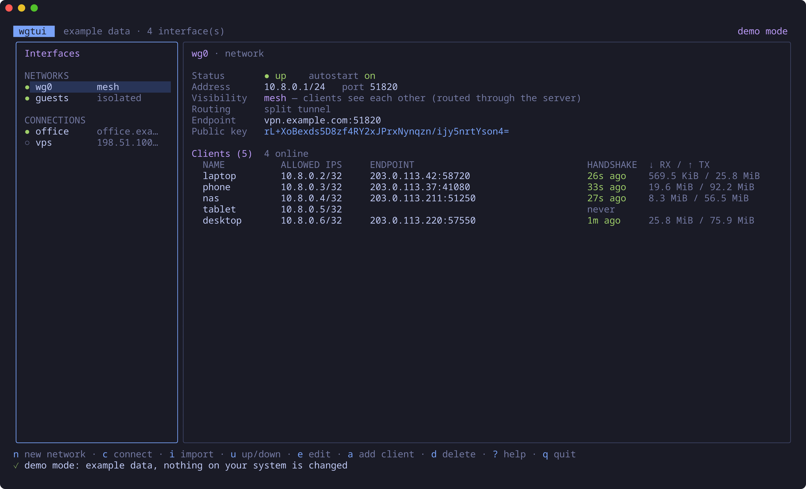
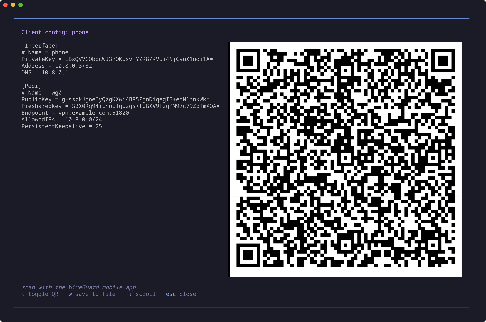
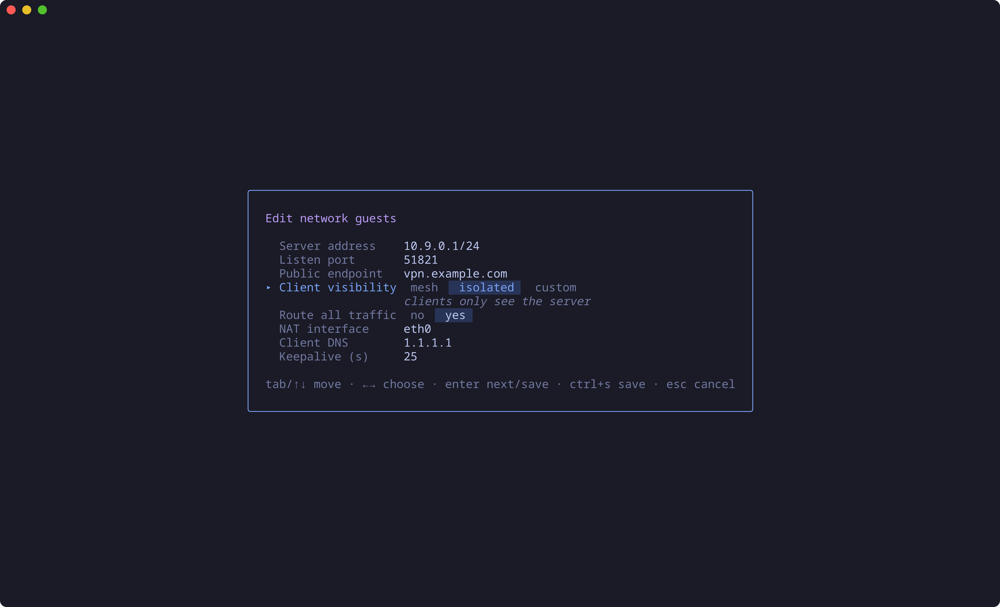
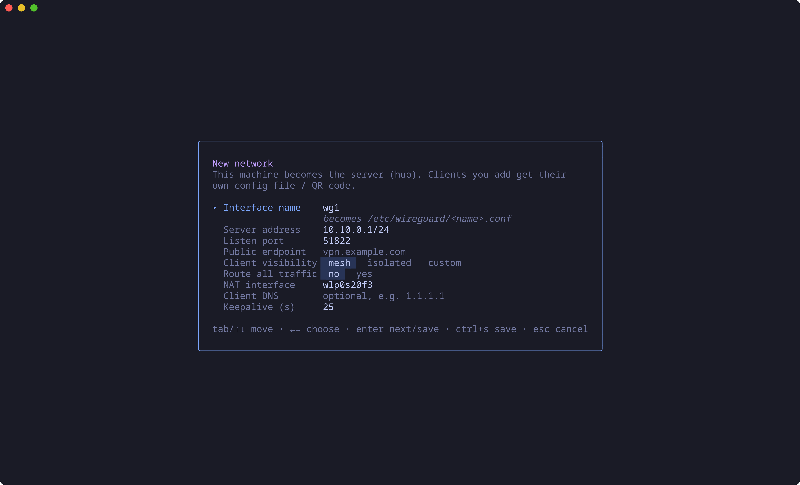
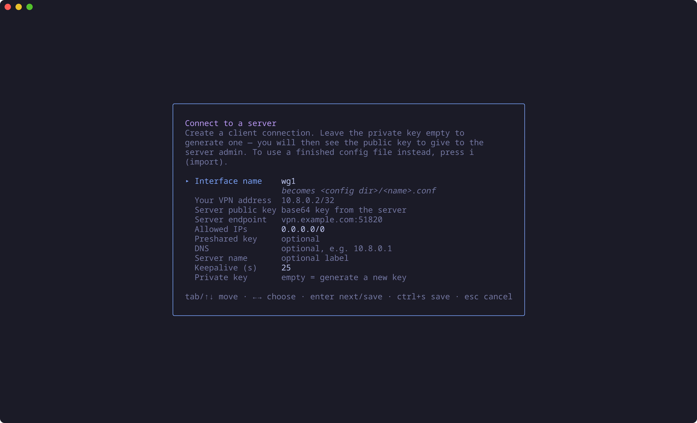
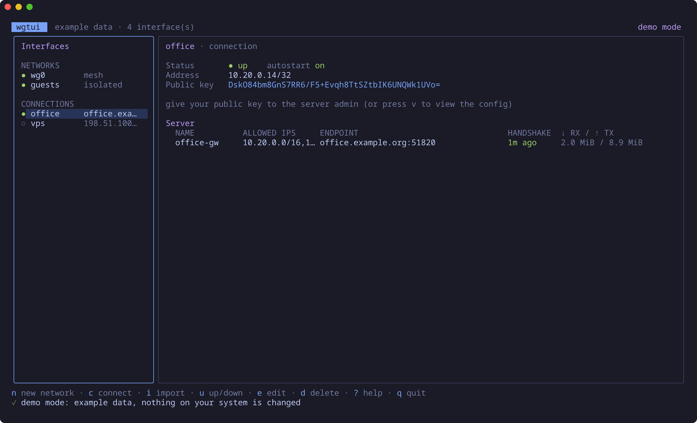

# wgtui

A terminal UI for managing WireGuard: create virtual networks, add clients with one key press (config file + QR code), choose whether clients can see each other, and connect this machine to other WireGuard servers. wgtui picks up the configs that are already in `/etc/wireguard`, so you can start using it on an existing setup.



## Features

- **Virtual networks (server/hub).** Turn this machine into a WireGuard server with a subnet, port and public endpoint.
- **Client visibility per network:**
  - `mesh`: every client can reach every other client (routed through the server)
  - `isolated`: clients can only reach the server, and traffic between clients is dropped by the firewall
  - `custom`: wgtui leaves routing and firewall rules alone (the default for imported configs)
- **Full tunnel, if you want it.** Route all client internet traffic through the server with NAT, or keep a split tunnel.
- **Adding clients takes one key press.** wgtui generates the keys and a preshared key, assigns the next free IP, and shows the client config plus a **QR code** for the WireGuard mobile app. You can also export the config to a file.
- **Peers that bring their own keys.** Add a device by its public key (for site-to-site links or devices that generated their own keys).
- **Connect to servers.** Create a client connection (a key is generated and you get the public key to hand to the server admin), or import a `.conf` you got from a VPN provider or another wgtui server.
- **Works with existing setups.** Every `*.conf` in the config directory is read at startup. Networks and connections are detected automatically, peer names from `# Name = …` or `### Client …` comments (the format used by common install scripts) are recognised, and your own `PostUp`/`PostDown` rules and comments are kept.
- **Live status.** Shows whether each interface is up or down, each peer's last handshake and endpoint, RX/TX traffic and how many clients are online. Refreshes every 2 seconds.
- **Up/down and autostart.** Uses `wg-quick` and `systemctl enable wg-quick@<iface>`. Peer changes on a running interface are applied live with `wg syncconf`, so existing sessions stay connected.
- **Demo mode.** `wgtui --demo` lets you try everything without root and without touching your system.

## Screenshots

| Client config with QR code | Choosing client visibility |
|---|---|
|  |  |

| Create a network | Connect to a server |
|---|---|
|  |  |



## Installation

wgtui runs on Linux. At runtime it needs `wireguard-tools` (`wg`, `wg-quick`) and, for the mesh, isolated and full-tunnel modes, `iptables` (the `iptables-nft` variant works too).

### Install script

```sh
curl -fsSL https://raw.githubusercontent.com/KsmBl/wgtui/main/install.sh | sh
```

The script downloads the prebuilt binary for your architecture (amd64, arm64, arm, 386) into `/usr/local/bin` and checks the runtime dependencies. Options:

```sh
sh install.sh --source              # build from source with Go instead
sh install.sh --prefix ~/.local     # install to ~/.local/bin
sh install.sh --version v0.1.0      # install a specific release
sh install.sh --uninstall
```

### With Go

```sh
go install github.com/KsmBl/wgtui@latest
```

### From source

```sh
git clone https://github.com/KsmBl/wgtui.git
cd wgtui
make build && sudo make install
```

### Runtime dependencies

```sh
sudo apt install wireguard-tools iptables     # Debian / Ubuntu
sudo dnf install wireguard-tools iptables     # Fedora
sudo pacman -S wireguard-tools iptables       # Arch
```

## Usage

```sh
sudo wgtui                       # manage /etc/wireguard
sudo wgtui -dir /path/to/confs   # use another config directory
wgtui --demo                     # try it with example data, no root needed
```

wgtui needs root to write `/etc/wireguard`, to run `wg-quick` and to read live status.

### Create a network and add clients

1. Press `n` and fill in the form. The defaults are usually fine: the next free `10.x.0.1/24` subnet and the next free port starting at 51820.
   - **Public endpoint**: the public IP or DNS name your clients connect to. Clients need it in their config.
   - **Client visibility**: `mesh` or `isolated` (switch with ←/→).
   - **Route all traffic**: `yes` sends all client traffic through the server, with NAT on the uplink interface you choose.
2. Press `u` to start the network, and `b` if it should start at boot.
3. Press `a` to add a client. A QR code and the config are shown right away. Scan the code with the WireGuard app, or press `w` to save a `.conf` file.
4. Make sure the UDP port is open in your firewall or forwarded on your router.

You can change the visibility mode later with `e`. Client configs are generated on demand, so after a mode change you can re-export or re-scan them to pick up the new `AllowedIPs`.

### Connect to a server

- **You have a config file:** press `i` and enter its path.
- **You only have the server details:** press `c` and enter your VPN address, the server's public key and endpoint. Leave *Private key* empty: wgtui generates one and shows your public key, which the server admin adds as a peer. If the server also runs wgtui, they select the network and press `p` (add peer by public key).

Then press `u` to connect.

### Keys

| Key | Action |
|---|---|
| `↑↓` / `j k` | move |
| `tab`, `←→`, `enter` | switch between the interface list and peers |
| `n` | new network |
| `c` | connect to a server |
| `i` | import a `.conf` file |
| `u` / `space` | bring the interface up / down |
| `b` | toggle autostart at boot |
| `e` | edit network/connection, or rename a peer |
| `a` | add client (generates keys, config and QR) |
| `p` | add peer by public key |
| `enter` / `s` | show a client's config and QR code |
| `w` | write a client config to a file |
| `v` | view the interface config (private keys hidden) |
| `d` | delete the interface or peer |
| `r` | reload from disk |
| `?` | help |
| `q` | quit |

## How it works

- Each `/etc/wireguard/<name>.conf` is a normal `wg-quick` config. wgtui never adds keys that `wg-quick` doesn't understand: peer names are stored as `# Name = …` comments.
- Extra data lives in `/etc/wireguard/wgtui/<name>.json` (mode `0600`): the network mode, public endpoint, client DNS, keepalive, and the private keys of clients created by wgtui, which are needed to show their config or QR code again later.
- Firewall rules for the mesh, isolated and full-tunnel modes are written into the `[Interface]` section between `# wgtui:begin` and `# wgtui:end`. wgtui only rewrites that block and leaves your own `PostUp`/`PostDown` lines alone. The rules it generates:
  - `mesh`: `iptables -I FORWARD -i %i -o %i -j ACCEPT`, plus IP forwarding. Clients get the whole subnet as `AllowedIPs`.
  - `isolated`: `iptables -I FORWARD -i %i -o %i -j DROP`. Clients get only the server's `/32` as `AllowedIPs`, and the server enforces isolation even if a client changes its config.
  - full tunnel: `FORWARD` accept rules and `MASQUERADE` on the uplink. Clients get `0.0.0.0/0`.
- Configs that wgtui didn't create (e.g. from wireguard-install scripts) show up as *detected*. They are not changed until you edit them or add or remove a peer. Peers that were imported this way have no stored private key, so wgtui can't show a config for them, but you can still rename or remove them.

## Development

```sh
make test          # go vet + tests
make build         # ./wgtui
make release       # cross-compiled binaries in dist/
make screenshots   # regenerate docs/screenshots (needs charmbracelet/freeze)
```

The project is written in Go with [Bubble Tea](https://github.com/charmbracelet/bubbletea) and [Lip Gloss](https://github.com/charmbracelet/lipgloss).

## License

[MIT](LICENSE)
